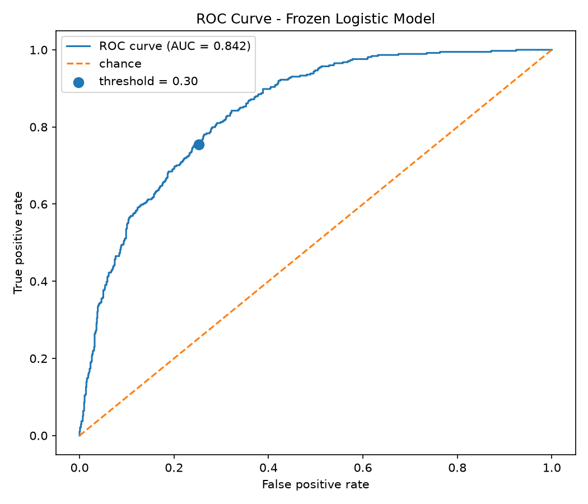
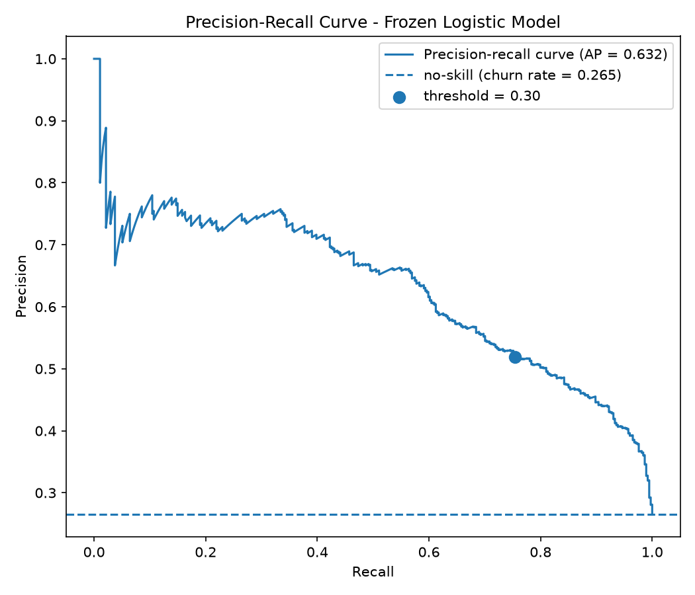
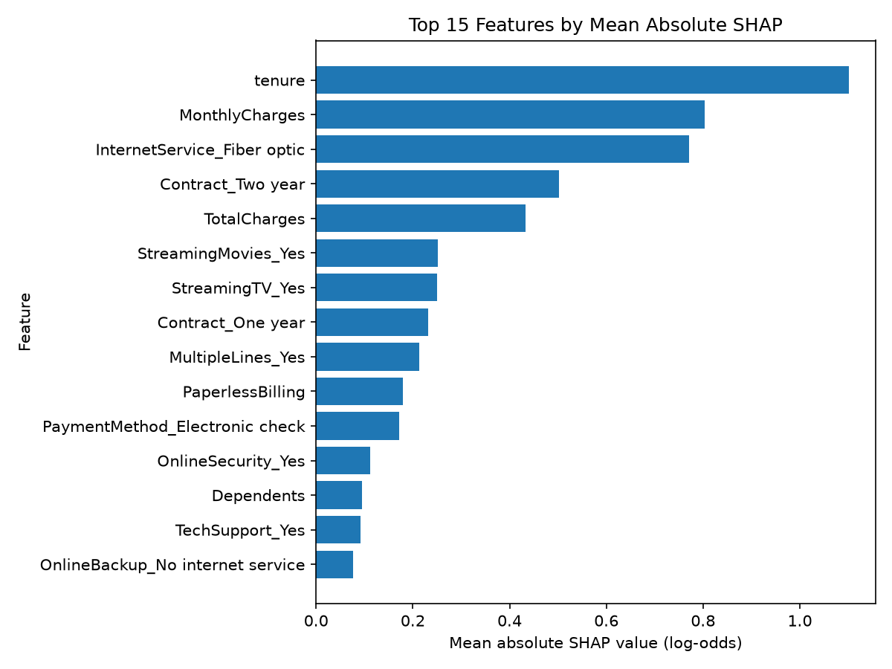

# Churn Intelligence System

This project prepares customer data, compares machine-learning models, and evaluates a frozen churn model using a held-back test set. It also summarizes churn patterns and explains how the frozen model makes predictions.

## Key results

The frozen model is logistic regression with a probability cutoff of **0.30**. Its test evaluation used **1,409 customers**, including **374 churners**.

| Test metric | Result | 95% test-sample interval |
| ----------- | -----: | -----------------------: |
| ROC-AUC     | 0.8418 |           0.8188–0.8624 |
| Recall      | 0.7540 |           0.7119–0.7946 |
| Precision   | 0.5193 |           0.4770–0.5599 |
| F1          | 0.6150 |           0.5760–0.6497 |

At the 0.30 cutoff, the model caught 282 of the 374 churners in the test set and flagged 261 customers who stayed. The test set was used once, after the model and cutoff were frozen.

## What the data shows

Observed churn rates in the public dataset vary by contract and tenure; these are patterns, not causes.

| Contract       | Churn rate |
| -------------- | ---------: |
| Month-to-month |      42.7% |
| One year       |      11.3% |
| Two year       |       2.8% |

| Tenure (months) | Churn rate |
| --------------- | ---------: |
| 0-12            |      47.4% |
| 13-24           |      28.7% |
| 25-48           |      20.4% |
| 49-72           |       9.5% |

## Pipeline

- SQL analysis: PostgreSQL summaries by contract, tenure, and payment method.
- Quality and preparation: validate, clean, encode, and split the data.
- Leakage checks: look for row overlap, target-in-feature errors, and suspicious correlations.
- Model comparison: a naive baseline (ROC-AUC 0.500) and five models (logistic regression, random forest, XGBoost, TensorFlow/Keras and PyTorch networks) under the same cross-validation protocol; the five models fall within 0.825–0.846 ROC-AUC.
- Tuning: compare logistic-regression and XGBoost settings on training data.
- Freeze the logistic pipeline and training-derived cutoff; evaluate on the test set once.
- SHAP: explain model contributions using training rows.

## Figures


ROC curve and frozen operating point.


Precision-recall curve and frozen operating point.


Training-row feature ranking by mean absolute SHAP value.

## Repository layout

Tracked folders: `data/` (placeholders), `reports/` (reports and figures), `sql/` (queries), `src/` (modules), `tests/`, and `tools/`. Top-level configuration includes `docker-compose.yml` and `requirements.txt`.

Key `src/` modules: `load_data.py` loads the CSV; `load_to_sql.py` and `run_query.py` load and query PostgreSQL; `run_quality_report.py` and `quality_checks.py` check data; `prepare_data.py`, `clean_data.py`, and `encode_data.py` prepare and split it; `leakage_checks.py` checks partition and feature risks; `torch_model.py` compares the baseline and five models; `tuning.py` searches settings; `final_model.py` saves the frozen pipeline; `final_evaluation.py` evaluates it; `explainability.py` computes SHAP; `evaluation_plots.py` draws evaluation figures.

The customer CSV and saved model artifact are not tracked. `.\.venv\Scripts\python.exe -m src.final_model` recreates the saved model from the local CSV.

## Setup and how to run

Commands are written for Windows PowerShell. Use Python 3.12 (developed with 3.12.6).

Create a virtual environment and install the packages listed in `requirements.txt`:

```powershell
py -3.12 -m venv .venv
.\.venv\Scripts\python.exe -m pip install -r requirements.txt
```

Place one CSV in `data/raw/`: **Telco Customer Churn** on Kaggle, from **IBM sample data sets**, uploaded by **BlastChar**. The CSV is not included in this repository.

The SQL steps need PostgreSQL. The tracked `docker-compose.yml` defines the service. 

Copy `.env.example` to `.env`, then open `.env` and replace the value of `POSTGRES_PASSWORD` with a password of your choice. Make sure Docker Desktop is running, then start the database:

```powershell
Copy-Item .env.example .env
docker compose up -d --wait
```

The modeling steps read the CSV directly and do not need the database.

Main commands, in order:

```powershell
# SQL commands require the configured database and local .env settings.
.\.venv\Scripts\python.exe -m src.load_to_sql
.\.venv\Scripts\python.exe -m src.run_query sql\03_churn_by_contract.sql
.\.venv\Scripts\python.exe -m src.run_query sql\04_churn_by_tenure.sql
.\.venv\Scripts\python.exe -m src.run_query sql\05_churn_by_payment_method.sql

# Quality, preparation, and checks.
.\.venv\Scripts\python.exe -m src.run_quality_report
.\.venv\Scripts\python.exe -m src.run_quality_report --cleaned
.\.venv\Scripts\python.exe -m src.prepare_data
.\.venv\Scripts\python.exe -m src.leakage_checks

# Training-data comparison and tuning.
.\.venv\Scripts\python.exe -m src.torch_model
.\.venv\Scripts\python.exe -m src.tuning

# Freeze, then evaluate the test set once.
.\.venv\Scripts\python.exe -m src.final_model
.\.venv\Scripts\python.exe -m src.final_evaluation
.\.venv\Scripts\python.exe -m src.bootstrap_intervals
.\.venv\Scripts\python.exe -m src.evaluation_plots

# Training-data explanations from the saved model.
.\.venv\Scripts\python.exe -m src.explainability
```

## Tests

Run the automated test suite with:

```powershell
.\.venv\Scripts\python.exe -m pytest -q
```

The most recent run collected and passed **50 tests**.

## Limitations and honest notes

- This is public data, not company customer data; results may not transfer to a specific business.
- The confidence intervals describe test-sample variation only.
- Gender is a model input; a next version should drop it and evaluate the change.
- Duplicate and overlapping inputs mean individual coefficients are not isolated effects.
- The model misses most churners among long-tenure customers: its training out-of-fold recall for the 49-72 month group was 28.7%.
- Illustrative cost scenarios produced different preferred cutoffs and were not used to set the frozen threshold.
